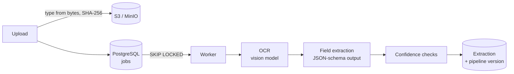

# docflow-ai

[](https://github.com/Shivasaireddy007/docflow-ai/actions/workflows/ci.yml)
[](LICENSE)


A document-intelligence pipeline for receipts and invoices: upload a document, and self-hosted
models read it (OCR), extract its fields, and score each field's confidence with checks you can
verify. Confident results can be approved automatically; the rest go to a person.

## Status

Built in stages; each is complete and tested before the next starts.

| Stage | Scope | Status |
|---|---|---|
| 1 | Django REST API, tenants and API keys, uploads to S3/MinIO, OCR and extraction with self-hosted models, confidence checks, job queue, Docker, CI | ✅ Done |
| 2 | Versioned validation rules, auto-approve vs. human review, React reviewer UI, audit trail | Next |
| 3 | Content-addressed result cache, rate limiting, tracing, evaluation on a labelled public dataset | |
| 4 | AWS with Terraform: Step Functions and container Lambdas, DynamoDB, RDS, KMS, canary deploys, SLO alarms | |
| 5 | vLLM serving benchmark on a GPU; demo and release | |

## How it works



## First results

Five receipts from the public [CORD](https://huggingface.co/datasets/naver-clova-ix/cord-v2) test
set, photographed in real conditions (one with a hand's shadow across it), on an Apple M5 laptop
with `qwen2.5vl:3b` for OCR and `qwen2.5:7b` for extraction:

| Receipt | Extracted total | Correct | Confidence | At a 0.9 threshold |
|---|---|---|---|---|
| test-2 | 28,000 | ✅ | 1.00 | auto-approved |
| test-3 | 11,000 | ✅ | 0.95 | auto-approved |
| test-1 | 91,000 | ✅ | 0.70 | human review |
| test-0 | 60,000 | ✅ | 0.35 | human review |
| test-4 | 194,000 (the subtotal) | ❌ | 0.70 | human review: the arithmetic check caught it |

About 15 seconds per receipt (7 s OCR + 8 s extraction). Five receipts show the mechanism, not
accuracy; stage 3 evaluates the full labelled test set.

## Design decisions

- **Confidence you can check, not the model's opinion.** Language models don't report calibrated
  confidence, so every extracted value is tested: is it actually in the OCR text (catches invented
  values), is it well-formed, and does the receipt's arithmetic agree (items add up to the
  subtotal; subtotal + tax + service − discount = total). A document is only as confident as its
  weakest field, and a receipt without a total is never auto-approvable.
- **Matching numbers the way receipts print them.** 56100 is found as `56.100`, `56,100`,
  `56 100` or `Rp56100`, but never inside another number (`500` in `12,500`) or glued to the
  number in the next column.
- **Deterministic, constrained models.** Temperature 0 and a fixed seed, so the same document
  gives the same result; extraction output is constrained to a JSON schema; output length is capped
  so a model that starts repeating itself stops.
- **Every result says what produced it.** Extractions store a pipeline version (OCR model,
  extraction model, prompt version), so results from a model upgrade can be compared or rolled back.
- **A queue that survives crashes.** Workers claim jobs with `SELECT … FOR UPDATE SKIP LOCKED`, so
  several run side by side without blocking each other; no row lock is held during the seconds a
  model takes. Failures retry with exponential backoff, a broken file fails at once, and a job left
  by a crashed worker is reclaimed when its lock times out.
- **Files judged by their bytes.** The type comes from the file's signature, not its name or
  Content-Type; damaged images and PDFs are rejected at upload; large pages are scaled down for the
  model.
- **Tenants are isolated.** Every query is scoped to the caller's tenant (other tenants' documents
  are a 404), storage keys are per tenant, and API keys are stored only as hashes and compared in
  constant time.
- **Uploads are idempotent.** Files are content-addressed (SHA-256) per tenant: uploading the same
  file again returns the existing document, including when two uploads race.

## API

Authenticate with `Authorization: Api-Key <key>`. Interactive docs at `/api/docs/`; the spec is in
[`docs/openapi.yaml`](docs/openapi.yaml).

| Method | Endpoint | Purpose |
|---|---|---|
| POST | `/api/v1/documents` | Upload a PDF, PNG, JPEG or WebP (`201`, or `200` if already uploaded) |
| GET | `/api/v1/documents` | List documents, newest first; `?status=queued\|processing\|extracted\|failed` |
| GET | `/api/v1/documents/{id}` | A document with its latest extraction: each field's value, confidence and checks |
| POST | `/api/v1/documents/{id}/reprocess` | Run it through the current pipeline again |
| GET | `/health`, `/ready` | Liveness and readiness |

## Running locally

You need Python 3.12 with [uv](https://docs.astral.sh/uv/), PostgreSQL and
[Ollama](https://ollama.com).

```bash
ollama pull qwen2.5vl:3b && ollama pull qwen2.5:7b    # about 8 GB

cd backend
uv sync
createdb docflow
uv run python manage.py migrate
uv run python manage.py create_tenant "Acme"           # prints an API key once
uv run python manage.py runserver                      # API at http://127.0.0.1:8000/api/docs/
uv run python manage.py run_worker                     # in another terminal
```

```bash
curl -H "Authorization: Api-Key <key>" -F "file=@receipt.jpg" http://127.0.0.1:8000/api/v1/documents
```

### With Docker

```bash
docker compose up --build -d     # PostgreSQL, MinIO, API, worker; Ollama runs on the host
docker compose exec api python manage.py create_tenant "Acme"
scripts/smoke-test.sh <key>
```

## Tests and checks

```bash
cd backend
uv run pytest && uv run ruff check . && uv run mypy .
```

CI runs strict type checks, the tests against PostgreSQL, a check for missing migrations and an
up-to-date API spec, and the whole Docker Compose stack end to end with a stand-in for the models.

## License

[MIT](LICENSE)
