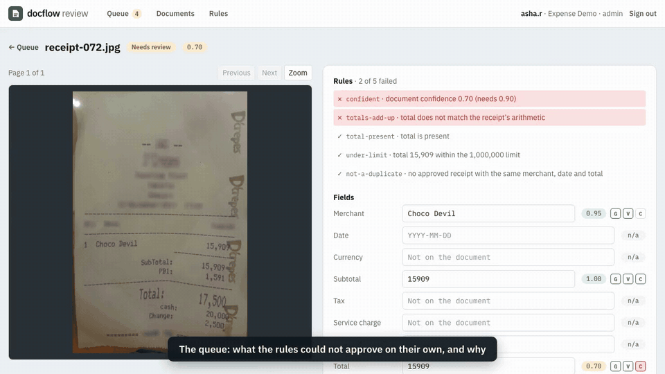
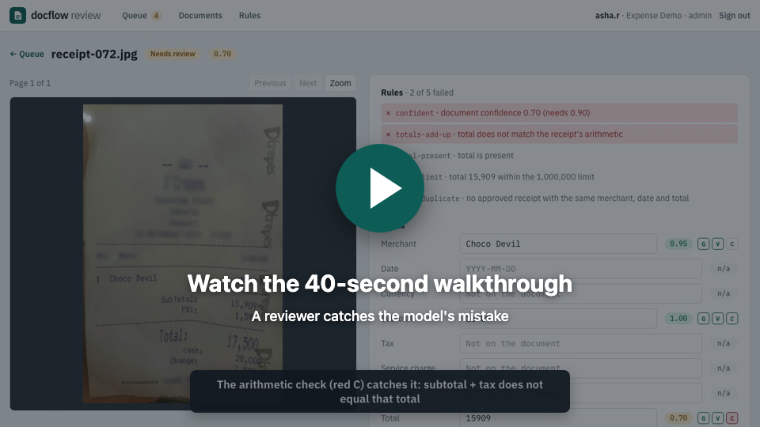
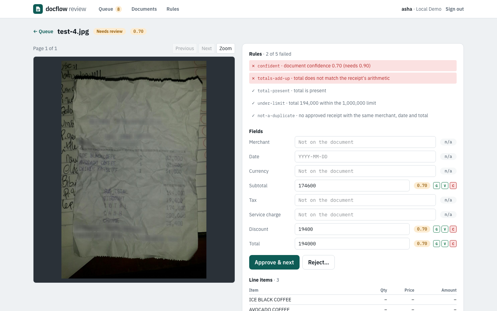
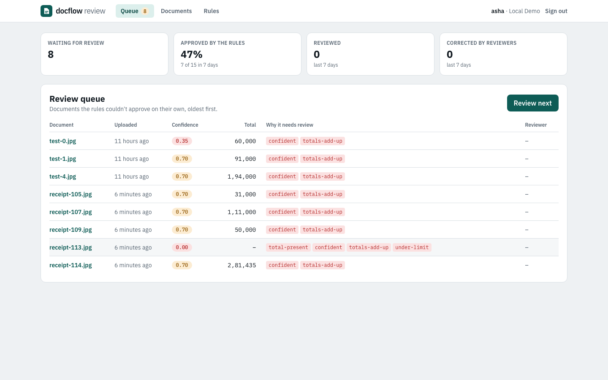
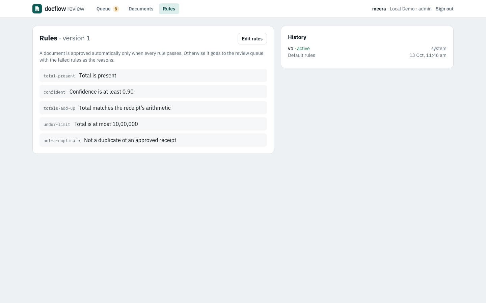
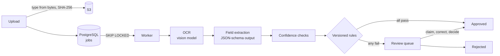

# docflow-ai

[](https://github.com/Shivasaireddy007/docflow-ai/actions/workflows/ci.yml)
[](https://github.com/Shivasaireddy007/docflow-ai/releases)
[](LICENSE)


A document-intelligence pipeline for receipts and invoices: upload a document, and self-hosted
models read it (OCR), extract its fields, and score each field's confidence with checks you can
verify. Versioned rules approve what they can; everything else goes to a review queue where a
person corrects and decides, with every step in an append-only audit trail.

**On the 100 labelled receipts of the CORD test set: 52% approved automatically with no wrong
total among them, and every one of the 14 wrong totals sent to a person**
([evaluation](docs/evaluation/README.md)).



[](docs/media/walkthrough.mp4)



| Review queue | Rules |
|---|---|
|  |  |

## Status

Built in stages; each is complete and tested before the next starts.

| Stage | Scope | Status |
|---|---|---|
| 1 | Django REST API, tenants and API keys, uploads to S3 (RustFS locally), OCR and extraction with self-hosted models, confidence checks, job queue, Docker, CI | ✅ Done |
| 2 | Versioned validation rules, auto-approve vs. human review, React reviewer UI, audit trail | ✅ Done |
| 3 | Content-addressed result cache, rate limiting, tracing, evaluation on a labelled public dataset | ✅ Done |
| 4 | AWS with Terraform: Step Functions and container Lambdas, DynamoDB, KMS, canary deploys, SLO alarms ([infra](infra/README.md)) | ✅ Built and tested in CI; deploying needs an AWS account |
| 5 | Serving benchmark for the OCR model ([bench](bench/README.md)) | ✅ Laptop baseline; the vLLM run needs a rented GPU |

## How it works



Every step is written to an append-only audit trail.

## Results

From [the evaluation](docs/evaluation/README.md) on the 100 receipts of the
[CORD](https://huggingface.co/datasets/naver-clova-ix/cord-v2) test set (real photos: crumpled,
shadowed, store details blurred), with `qwen2.5vl:3b` for OCR and `qwen2.5:7b` for fields on an
Apple M5 laptop:

| Judged on the total | Prompt 1 | Prompt 2 (default) |
|---|---|---|
| Totals extracted correctly | 76% | **85%** |
| Approved automatically | 42% | **52%** |
| Wrong totals among the auto-approved | 0 | **0** |
| Wrong totals sent to a person | 22 of 22 | 14 of 14 |

Prompt 2 came from reading prompt 1's mistakes: totals printed as `DUE`, the CASH amount taken as
the total, labels and amounts in separate columns. It added cash and change to the extracted
fields, which gives the checks a second equation (total = cash − change). Re-evaluating it re-ran
only extraction: OCR results came from the cache. About 24 s per receipt on the laptop; a document
processed before by the same versions takes under a millisecond.

## Design decisions

### Pipeline

- **Confidence you can check, not the model's opinion.** Language models don't report calibrated
  confidence, so every extracted value is tested: is it actually in the OCR text (catches invented
  values), is it well-formed, and does the receipt's arithmetic agree (items add up to the
  subtotal; subtotal + tax + service − discount = total). A document is only as confident as its
  weakest field, and a receipt without a total is never auto-approvable.
- **Matching numbers the way receipts print them.** 56100 is found as `56.100`, `56,100`,
  `56 100` or `Rp56100`, but never inside another number (`500` in `12,500`) or glued to the
  number in the next column.
- **Deterministic, constrained models.** Temperature 0 and a fixed seed, so the same document
  gives the same result; extraction output is constrained to a JSON schema; output length is capped
  so a model that starts repeating itself stops.
- **Every result says what produced it.** Extractions store a pipeline version (OCR model,
  extraction model, prompt version), so results from a model upgrade can be compared or rolled back.
- **A queue that survives crashes.** Workers claim jobs with `SELECT … FOR UPDATE SKIP LOCKED`, so
  several run side by side without blocking each other; no row lock is held during the seconds a
  model takes. Failures retry with exponential backoff, a broken file fails at once, and a job left
  by a crashed worker is reclaimed when its lock times out.
- **Files judged by their bytes.** The type comes from the file's signature, not its name or
  Content-Type; damaged images and PDFs are rejected at upload; large pages are scaled down for the
  model.
- **Tenants are isolated.** Every query is scoped to the caller's tenant (other tenants' documents
  are a 404), storage keys are per tenant, and API keys are stored only as hashes and compared in
  constant time.
- **Uploads are idempotent.** Files are content-addressed (SHA-256) per tenant: uploading the same
  file again returns the existing document, including when two uploads race.

### Cost and reliability

- **The same content never goes to a model twice.** Model results are cached under
  `(tenant, step version, SHA-256 of exactly what the model sees)`: page images for OCR, OCR text
  for extraction. A new extraction prompt re-runs extraction and reuses OCR; a new OCR model re-runs
  both. Keys are per tenant, so timing can't reveal what another tenant uploaded. Redis locally,
  DynamoDB on AWS; if the store is down, results are computed uncached.
- **Rate limits as token buckets in Redis.** One atomic Lua script on Redis's own clock, shared by
  every process: uploads per tenant, sign-ins per username and address, and model calls across all
  workers, so a burst of uploads queues instead of overwhelming the model server. Over the limit,
  the API answers `429` with `Retry-After`; a worker waits, then retries the job later.
- **Repetition loops are handled, not just retried.** Vision models sometimes fall into "0000…"
  until stopped, and at temperature 0 they do it every time on the same page. The pipeline detects
  it (Ollama's abort, or output cut off at the token limit) and reads that page once more with a
  repeat penalty and a little seeded sampling; if it still loops, the document fails at once with
  a clear reason instead of wasting retries. In the evaluation this rescued 3 of 100 receipts.
- **Traced end to end.** OpenTelemetry spans for each request, SQL query, Redis call, model call and
  pipeline step (render, OCR, extract, score), with cache hits and confidence as attributes; Jaeger
  in Docker Compose, X-Ray on AWS.
- **Measured, not assumed.** The evaluation harness runs the production code on labelled receipts
  and reports per-field precision and recall, the auto-approval rate and its error rate, how many
  wrong totals reach a person, and a threshold sweep. The default confidence threshold (0.9) comes
  from it: at 0.5, two wrong totals would have been approved.

### Review

- **Rules are data, versioned per tenant.** A rule set is a list like
  `{"type": "max_amount", "field": "total", "max": 1000000}`, validated before it is published.
  Versions are never edited, a partial unique index allows one active version per tenant, and
  every decision records the version that made it, so "why was this approved?" always has an answer.
- **Approve only when every rule passes.** By default: a total is present, confidence ≥ 0.9, the
  arithmetic agrees, the amount is under a limit, and it isn't a duplicate. Anything else goes to
  the queue with the failed rules as the reasons.
- **Duplicates are caught across documents.** A second photo of an approved receipt (same merchant,
  date and total) goes to review. Two copies processed at the same moment can't both slip through:
  the check runs under a PostgreSQL advisory lock on the receipt's fingerprint.
- **Two reviewers never review the same document.** "Review next" leases the oldest unclaimed
  document with `SKIP LOCKED`; a lease left in a closed tab expires after 15 minutes. A decision is
  refused (`409`) if the document was already decided or someone else holds it.
- **Corrections are parsed like model output.** A reviewer typing `174.600` gets 174600, and the
  decision stores each change as `{"from": 194000, "to": 174600}`.
- **An audit trail that can't be rewritten.** Uploads, extractions, rule decisions, claims and
  reviews are recorded with who did them; a database trigger rejects any UPDATE or DELETE on the
  audit table, so not even a bug or an admin can change history.
- **Two kinds of caller.** Machines use API keys; reviewers sign in with a session cookie
  (HttpOnly, SameSite, CSRF-protected). The web app is served from the same origin as the API, so
  no tokens live in JavaScript.

## On AWS

[`infra/`](infra/README.md) is the serverless version of the processing path, in Terraform: an
upload to S3 starts a Step Functions execution that runs the same pipeline code as four container
Lambdas (prepare, OCR, extract, decide), with results in DynamoDB keyed `<tenant>#<sha256>`.
Model steps retry with backoff and capped concurrency; failures are marked and sent to a
dead-letter queue; everything is encrypted with one customer-managed KMS key; deploys are
CodeDeploy canaries from GitHub Actions over OIDC, rolled back by CloudWatch alarms; a budget
alarm guards cost. CI checks it all without an AWS account: `terraform test` against a mocked
provider, the state machine in Step Functions Local, the handlers against moto, and the Lambda
image invoked locally.

## API

Authenticate with `Authorization: Api-Key <key>`. Interactive docs at `/api/docs/`; the spec is in
[`docs/openapi.yaml`](docs/openapi.yaml).

| Method | Endpoint | Purpose |
|---|---|---|
| POST | `/api/v1/documents` | Upload a PDF, PNG, JPEG or WebP (`201`, or `200` if already uploaded) |
| GET | `/api/v1/documents` | List documents, newest first; `?status=queued\|processing\|extracted\|failed` |
| GET | `/api/v1/documents/{id}` | A document with its latest extraction: each field's value, confidence and checks |
| POST | `/api/v1/documents/{id}/reprocess` | Run it through the current pipeline again (not once decided) |
| GET | `/api/v1/documents/{id}/pages/{n}` | A page as an image |
| POST | `/api/v1/auth/login`, `/auth/logout`; GET `/auth/me` | Reviewer sessions |
| GET | `/api/v1/review/queue`, `/review/stats` | Documents waiting for review; approval and correction rates |
| POST | `/api/v1/review/next` | Claim the next document to review |
| GET | `/api/v1/review/documents/{id}` | Extraction, decisions and audit trail |
| POST | `/api/v1/review/documents/{id}/decision` | Approve or reject, with corrections |
| GET / POST | `/api/v1/rules` | Rule versions; publish a new one (admins) |
| GET | `/health`, `/ready` | Liveness and readiness |

## Running locally

You need Python 3.12 with [uv](https://docs.astral.sh/uv/), PostgreSQL, Redis and
[Ollama](https://ollama.com) (or any OpenAI-compatible model server: set `MODEL_API=openai` and
`MODEL_URL`).

```bash
ollama pull qwen2.5vl:3b && ollama pull qwen2.5:7b    # about 8 GB

cd backend
uv sync
createdb docflow
uv run python manage.py migrate
uv run python manage.py create_tenant "Acme"           # prints an API key once
uv run python manage.py create_reviewer acme asha --admin
uv run python manage.py runserver                      # API at http://127.0.0.1:8000/api/docs/
uv run python manage.py run_worker                     # in another terminal
```

```bash
curl -H "Authorization: Api-Key <key>" -F "file=@receipt.jpg" http://127.0.0.1:8000/api/v1/documents

# Review app: http://localhost:5173 (proxies /api to the backend)
cd frontend && npm ci && npm run dev
```

Evaluate on the labelled CORD receipts (downloads them once):

```bash
cd backend && uv run python -m evaluation.run --limit 100 --out ../docs/evaluation/my-run
```

### With Docker

```bash
docker compose up --build -d     # PostgreSQL, Redis, RustFS (S3), Jaeger, API, worker, web; Ollama on the host
docker compose exec api python manage.py create_tenant "Acme"
docker compose exec api python manage.py create_reviewer acme asha --admin   # review app at http://localhost:8080
scripts/smoke-test.sh <key>
```

## Tests and checks

```bash
cd backend && uv run pytest && uv run ruff check . && uv run mypy .
cd frontend && npm test && npm run typecheck && npm run lint
```

CI runs four jobs on every push:

- **backend:** ruff, strict mypy, tests against PostgreSQL and Redis, no missing migrations, an
  up-to-date API spec.
- **frontend:** generated API types up to date, type check, lint, tests, build.
- **aws:** Terraform format, validate, tflint and `terraform test`; the state machine in Step
  Functions Local; the Lambda image built and invoked.
- **stack:** the whole Docker Compose stack with a stand-in for the models, an API smoke test,
  then a Playwright test where an admin tightens a rule, uploads a receipt, and reviews what the
  rule sends to the queue.

## License

[MIT](LICENSE)
