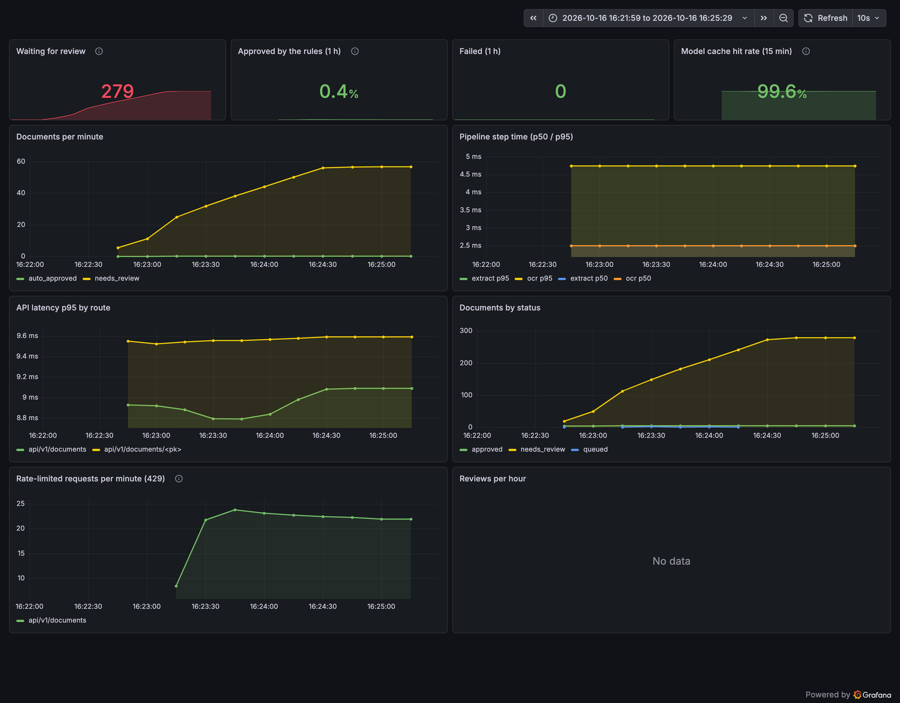

# Load test

[`load.js`](load.js) is a [k6](https://k6.io) test of the API and pipeline under mixed traffic. It
uses the model stand-in ([`e2e/ollama_stub.py`](../../e2e/ollama_stub.py)) instead of real models,
so it measures the system around the models: uploads, the job queue, workers, rules, the database
and rate limits. Model throughput is measured separately in the [serving benchmark](../README.md).

Three scenarios run together for two minutes:

| Scenario | Traffic |
|---|---|
| uploads | 2 new receipts a second, spread over 4 tenants |
| browsing | 20 reviewer reads a second: a document list, then a document's details |
| burst | a fifth tenant uploading 5 a second for 30 s, far past its limit of 30 at once, then one every 2 s |

## Results

On an Apple M5 laptop (16 GB): Gunicorn with 4 processes, 2 pipeline workers, PostgreSQL and Redis
on the same machine.

| | Result | Threshold |
|---|---|---|
| Reviewer reads, p95 | **7.5 ms** (4,766 requests, none failed) | < 150 ms |
| Uploads, p95 | **11.4 ms** (all 201) | < 300 ms |
| Upload to decision, p50 / p95 | **508 ms / 965 ms** (284 documents) | |
| Burst tenant | **107 of 150 uploads refused with 429**, the rest accepted | as the token bucket allows |
| Documents left queued or failed | **0** | |

Upload-to-decision time is mostly the workers' 1-second idle poll; the pipeline itself takes a few
milliseconds with the stand-in.



Reading the dashboard:

- **Almost everything went to review, which is correct.** Every upload is the same receipt with
  random bytes appended, so after the first one per tenant each is a duplicate (same merchant, date
  and total as an approved receipt). Exactly one per tenant was approved, 5 in all, although
  uploads ran concurrently on two workers: the duplicate check runs under a PostgreSQL advisory
  lock.
- **The model cache hit rate is 99.6%.** The appended bytes change the file's SHA-256 but not the
  page image, and the cache is keyed on what the model sees, so the model ran once per tenant.
- **The 429s are the burst tenant only.** The other four tenants stayed under their limits and
  were never refused.

## Running it

The whole stack in Docker Compose, with the model stand-in from CI:

```bash
docker compose -f docker-compose.yml -f docker-compose.ci.yml up --build -d
for t in A B C D E; do docker compose exec -T api python manage.py create_tenant "Load $t"; done
k6 run -e BASE=http://localhost:8000 -e KEYS=<key1>,<key2>,<key3>,<key4> -e BURST_KEY=<key5> bench/load/load.js
```

Grafana is at http://localhost:3000 (the dashboard is provisioned; no sign-in needed to view).
