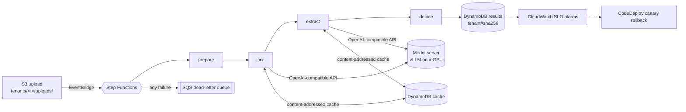

# AWS deployment

The serverless processing path: an upload to S3 starts a Step Functions execution that runs the
pipeline's steps as container Lambdas and records the decision in DynamoDB.



| Piece | Choice |
|---|---|
| Orchestration | Step Functions: model steps retry with exponential backoff and jitter; an unusable upload fails at once; every failure is marked on the document and sent, with its error, to an encrypted SQS dead-letter queue |
| Compute | One container image, four arm64 Lambdas; OCR and extraction have reserved concurrency so the model server sees at most `model_concurrency` calls |
| Results | DynamoDB keyed `<tenant>#<sha256>`, with `by_tenant` and `by_status` (review queue) indexes; point-in-time recovery |
| Duplicates | Repeat uploads are skipped by a conditional write; a second photo of an approved receipt is caught by a conditional write on its fingerprint |
| Rules | `config/rules/<tenant>.json` in the versioned bucket; each decision records the S3 version it used |
| Security | One customer-managed KMS key (rotating) for S3, DynamoDB, SQS, SNS, logs, ECR and Step Functions; TLS-only bucket policy; no public access; least-privilege roles; execution data kept out of logs |
| Operations | X-Ray tracing; CloudWatch alarms for the p95 upload-to-decision SLO, dead letters, step errors and model throttling; CloudWatch metrics from logs (embedded metric format) |
| Deploys | GitHub Actions with OIDC (no stored keys, main branch only), CodeDeploy canaries: 10% for 5 minutes, rolled back on the step's error alarm |
| Cost guard | A monthly AWS Budget that emails at 80% and on a forecast overrun |

## Checked without an AWS account

CI runs all of this on every push:

- `terraform validate`, `tflint` with the AWS ruleset, and `terraform test`: the whole
  configuration applied against a mocked provider, asserting encryption, private access, retries,
  concurrency caps, the OIDC trust condition, canary settings and alarms
  ([`tests/pipeline.tftest.hcl`](tests/pipeline.tftest.hcl)).
- The state machine in AWS Step Functions Local with mocked steps: a receipt end to end, a repeat
  upload, a busy model retried until it answers, a model that keeps failing ending in the
  dead-letter queue, and an unusable upload failing without retries.
- The Lambda handlers against moto's S3 and DynamoDB (`backend/tests/test_lambdas.py`).
- The Lambda image built and invoked through the Lambda runtime interface emulator.

## Deploying

You need an AWS account, Terraform ≥ 1.9, Docker, and a model server reachable from Lambda that
speaks the OpenAI-compatible API (vLLM on a GPU instance, see `../bench/`).

```bash
cd infra
terraform init
# 1. The image repository first, so there is an image for the Lambdas to start from.
terraform apply -target=aws_ecr_repository.pipeline -var model_url=https://models.example.com
REPO=$(terraform output -raw ecr_repository_url)
aws ecr get-login-password | docker login --username AWS --password-stdin "${REPO%%/*}"
docker buildx build --platform linux/arm64 --provenance=false -f ../backend/lambdas/Dockerfile \
  -t "$REPO:bootstrap" --push ../backend

# 2. Everything else.
terraform apply -var model_url=https://models.example.com -var alarm_email=you@example.com

# 3. Process a receipt.
aws s3 cp receipt.jpg "s3://$(terraform output -raw documents_bucket)/tenants/acme/uploads/receipt.jpg"
aws dynamodb query --table-name "$(terraform output -raw results_table)" --index-name by_tenant \
  --key-condition-expression "tenant_id = :t" --expression-attribute-values '{":t": {"S": "acme"}}'
```

Later deploys go through GitHub Actions: set the repository variables `AWS_DEPLOY_ROLE_ARN`
(`terraform output deploy_role_arn`) and `ECR_REPOSITORY_URL`, and every green CI run on main
builds the image and canaries it to each step.

**Cost.** Everything is pay-per-use except the KMS key (about $1 a month) and the CloudWatch
alarms (about $0.10 each, so about $0.80 a month for the 8 here). Processing costs Lambda time,
DynamoDB requests and S3 storage: cents per thousand documents, before the model server, which is
the real cost (see `../bench/`).

**Tearing down.** `terraform apply -var protect_data=false ...` to lift the results table's
deletion protection, then `terraform destroy` with the same variables.
